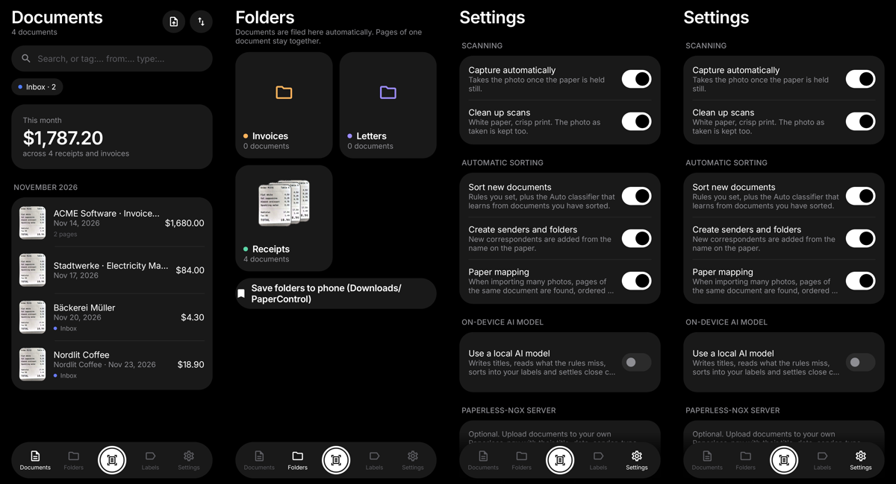
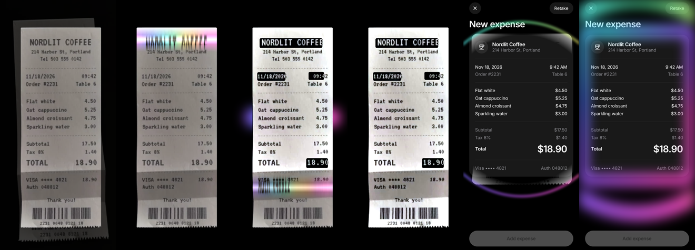

# PaperControl

A Paperless-ngx style document archive for Android, with more AI on top, and all of it
running on the phone.



- **Scan.** Live paper detection with corner brackets, auto-capture, torch. The photo is
  straightened and cleaned up, the text is read, and the page turns into a digital card in
  one continuous animation (below).
- **Read.** Receipts and invoices are parsed into merchant, address, date, time, order and
  table number, line items, subtotal, tax, total, card and auth code. English and German.
- **Sort automatically.** Tags, correspondents, document types and folders, with the
  Paperless-ngx matching algorithms (any word, all words, exact, regex, fuzzy, **Auto**).
  Auto is a classifier that learns from the documents you have already sorted. New senders
  are created from the name on the paper.
- **Paper mapping.** Import a pile of photos (or share them to the app). Pages of the same
  document are found, ordered and kept together as one document in its own folder. Long
  receipts photographed in parts are stitched in order.
- **Optional on-device AI model** (Gemma 4 E2B via LiteRT-LM): writes titles, fills in what
  the rules miss, sorts into your existing labels and settles close calls in paper mapping.
- **Optional Paperless-ngx server**: upload documents with title, date, correspondent, type,
  storage path (from the folder) and tags. Missing ones are created on the server.

Nothing leaves the phone unless you set up a Paperless-ngx server or download the AI model.

## The scan animation



Modeled on the reference video (Anuar D., "Scanning a receipt"), frame by frame:

| Time | Reference | Here |
|---|---|---|
| 0.0–0.7 s | Camera: close button, "Scan receipt", flash, "● Receipt detected" pill, corner brackets around the receipt, shutter with gallery on the left and "Auto" on the right | `CameraLayer`: the same controls. The brackets glide to the paper found by `QuadDetector`; "Auto" captures once the paper is still for ~0.9 s |
| 0.7–0.9 s | White flash; controls fade; background goes black, receipt stays | Shutter flash; the photo fades to black while the straightened scan settles from where the paper was |
| 0.9–2.4 s | An iridescent band sweeps down the receipt. Above it the paper is crisp and white, and merchant, date, time and total turn into black chips; inside the band the print smears | The band waits at the top edge until the text is read, then sweeps down. Above it you see the cleaned-up scan, and the chips are the **real** fields the parser found, at their OCR positions |
| 2.4–3.2 s | Hold | Hold while sorting finishes |
| 3.2–3.6 s | "New expense", close and Retake fade in; the receipt stretches to the card and dissolves through an expanding iridescent ring into the dark card | Same: the paper stretches to the card's shape first, then a ring opens and reveals the card |
| 3.6–4.5 s | Aura around the card fades; "Original photo · Attached to this expense" appears; the button turns white | Same, plus a "Sorted automatically" card showing where the document will be filed |

Colors, sizes and type were measured from the video: pure black background, `#191919`
cards, `#2B2B2B` icon circles, white pill buttons, Inter as the font.

`ScreenshotTest` renders these moments from a real capture (paper detection, flattening
and clean-up run on a frame of the receipt) into `app/build/screens/`.

## How it works

| Step | Code |
|---|---|
| Find the paper | `core/QuadDetector`: Otsu threshold → largest bright region → corners along the diagonals |
| Straighten and clean | `processing/Images`: perspective warp (`Matrix.setPolyToPoly`), paper to white, more contrast |
| Read text | `ml/TextReader`: ML Kit text recognition, bundled model, offline |
| Read fields | `core/ReceiptParser`: works on visual rows, so a label on the left and its price on the right are read together |
| Sort | `processing/Sorter`: your rules first, then the Auto classifier (`core/Classifier`, naive Bayes retrained whenever the archive changes), then what the paper says, then the AI model if it is on |
| Paper mapping | `core/PaperMapper`: scores every pair of pages, then clusters by average linkage |
| Store | `data/Store`: SQLite with an FTS4 full-text index |

### Paper mapping evidence

Each pair of pages gets a score from:

| For | Against |
|---|---|
| Same invoice, customer or order number | Different invoice or order numbers |
| "Page 1 of 3" / "Seite 2 von 3" markers that fit together | Page markers that clash |
| The last lines of one photo reappear at the top of the next one (a long receipt photographed in parts) | Different dates |
| Same sender, same date | Two different totals, each under its own letterhead |
| Similar wording (TF-IDF) | Photos taken more than a day apart |
| Letterhead without a total followed by a total without letterhead | Different paper color |
| Photos taken right after each other, same paper color | |

Pages are ordered by page number, then by text that continues from one photo to the next,
then letterhead first and total last, then by capture time. The import screen shows the
reasons and lets you move pages, split them off or join documents before saving.

## Paperless-ngx features

| Paperless-ngx | Here |
|---|---|
| Documents with title, created date, ASN, content | ✓ |
| Correspondents, document types, tags, inbox tags | ✓ |
| Storage paths | Folders; uploaded as storage paths |
| Matching: none, any, all, exact, regex, fuzzy, auto | ✓ |
| Full-text search, `tag:` / `correspondent:` / `type:` filters | ✓ plus `folder:`, `asn:`, `year:` |
| Saved views | ✓ |
| Custom fields | ✓ text, number, amount, date, yes/no, link |
| Notes | ✓ |
| Merge and split documents, reorder pages | ✓ |
| Consume from share / upload | ✓ share images or PDFs to the app, or import from the app |
| PDF export | ✓ share as PDF, or save every folder to `Downloads/PaperControl/<folder>/` |

## Build

```
./gradlew :app:testDebugUnitTest   # parser, matching, classifier, paper mapping, detection, screenshots
./gradlew :app:assembleDebug
```

The APK is at `app/build/outputs/apk/debug/app-debug.apk`; CI builds it on every push.
Android 9 or newer. The optional AI model needs about 3 GB of free memory.

### Signed releases (GitHub Actions)

The `release` job builds a signed APK on every push to `main`, on every `v*` tag, and when
started by hand (Actions → Build → Run workflow). For a `v*` tag it also publishes a GitHub
release with the APK attached. Version code is the run number, so each build installs over
the previous one.

It needs two repository secrets (Settings → Secrets and variables → Actions → New
repository secret):

| Secret | Value |
|---|---|
| `RELEASE_KEYSTORE_BASE64` | The keystore file, base64 encoded: `base64 -w0 papercontrol-release.jks` |
| `RELEASE_KEYSTORE_PASSWORD` | The keystore password |

The key alias is `papercontrol`, and the key password equals the keystore password; set
`RELEASE_KEY_ALIAS` / `RELEASE_KEY_PASSWORD` in the workflow if yours differ. The keystore
is never committed. Keep a copy somewhere safe: an installed app only accepts updates signed
with the same key.

To publish a release:

```
git tag v0.2.0 && git push origin v0.2.0
```

## Permissions

| Permission | Why |
|---|---|
| Camera | Scanning |
| Internet | AI model download, optional Paperless-ngx server |
| Notifications | Download progress |

Inter is licensed under the SIL Open Font License (`INTER_LICENSE.txt`).
